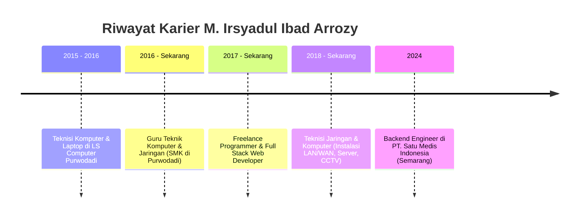

<!-- HEADER BANNER DENGAN TEMA EMERALD & DARK SLATE (SESUAI WEBSITE IRSYADPROJECT.MY.ID) -->

  

<!-- IDENTITAS & ROLE SESUAI WEBSITE IRSYADPROJECT.MY.ID -->
<h2 align="center">
  ⚡ Irsyad Project ⚡
</h2>
<h3 align="center">
  👨‍💻 Backend Engineer &bull; 👨‍🏫 Pendidik / Guru TKJ &bull; 🌐 Full Stack Developer
</h3>

  📍 <b>Purwodadi, Grobogan, Jawa Tengah, Indonesia</b>

  <i>"Membangun solusi digital yang inovatif dan berkualitas, menjembatani dunia pendidikan dan industri teknologi."</i>

<!-- STATUS KETERSEDIAAN PROYEK -->

  

<!-- BADGE MEDIA SOSIAL & KONTAK RESMI -->

  
  
  
  
  
  
  

---

### 📊 Ringkasan Profil & Statistik Kunci

  
  &nbsp;
  
  &nbsp;
  
  &nbsp;
  
  &nbsp;
  

---

### 👨‍💻 Tentang Saya (About Me)

Saya adalah seorang **Guru Teknik Komputer dan Jaringan (TKJ)** sejak tahun 2016 sekaligus **Freelance Programmer & Backend Engineer** sejak tahun 2017. Selama lebih dari 8-10 tahun, saya membangun karier di dua bidang ini secara paralel, menjembatani dunia pendidikan dan teknologi dengan semangat untuk terus belajar dan berinovasi.

* 🎓 **Pendidikan:** S1 Teknik Informatika — **STMIK Himsya Semarang** (2016 - 2020)
* 🏫 **Peran Akademis:** Guru TKJ di SMK Purwodadi, Grobogan (Mendidik & membimbing praktikum lab, administrasi server, dan pemrograman).
* 💼 **Karier Rekayasa Software:** Backend Engineer (PT. Satu Medis Indonesia - integrasi Satusehat Kemenkes, REST API, Laravel) & Freelance Full Stack Developer.
* 🛠️ **Teknisi Infrastruktur:** Berpengalaman dalam instalasi & troubleshooting jaringan LAN/WAN, routing MikroTik, server Linux/Windows, Proxmox VE, hingga sistem CCTV/IP-Cam.
* 💡 **Filosofi:** *"Teknologi dapat memberikan solusi nyata dalam dunia pendidikan dan kehidupan sehari-hari."*
* 📄 **Curriculum Vitae:** [Download CV Lengkap (PDF)](https://irsyadproject.my.id/CV_by_Profile_Linkedin_Irsyad.pdf)

---

### 🛠️ Keahlian & Teknologi (Tech Stack)

Sesuai dengan portofolio keahlian di [irsyadproject.my.id/about](https://irsyadproject.my.id/about):

#### 💻 1. Bahasa Pemrograman

  
  
  
  
  
  
  
  
  

#### ⚡ 2. Kerangka Kerja & Library (Frameworks)

  
  
  
  
  
  
  
  
  
  

#### 🗄️ 3. Basis Data, DevOps, Server & Jaringan

  
  
  
  
  
  
  
  
  
  

---

### 📂 Proyek Unggulan (Featured Projects)

Berikut adalah beberapa proyek unggulan yang telah dan sedang dikerjakan (dapat dilihat di [irsyadproject.my.id/projects](https://irsyadproject.my.id/projects)):

<table width="100%">
  <tr>
    <td width="50%" valign="top">
      <h3 align="center">📝 Zero Exam</h3>
      

        Aplikasi sistem ujian berbasis komputer (CBT) modern dengan fitur melimpah untuk institusi pendidikan dan sekolah.
      

      

        <b>Tech:</b> Laravel 13, Vue.js 3, Filament, PrimeVue
      

      

        <a href="https://irsyadproject.my.id/projects/zero-exam">🔍 Detail Proyek</a>
      

    </td>
    <td width="50%" valign="top">
      <h3 align="center">🏢 SIMASET / SIAPA CI4</h3>
      

        Sistem Informasi Akuntansi Manajemen Pengelolaan Aset Kantor Kecamatan Limbangan untuk penatausahaan dan inventarisasi aset daerah.
      

      

        <b>Tech:</b> CodeIgniter 4, Tailwind CSS, MySQL, Limitless
      

      

        <a href="https://irsyadproject.my.id/projects/sistem-informasi-akuntansi-pengelolaan-aset-kecamatan-limbangan">🔍 Detail Proyek</a> &bull; <a href="https://simaset.zerotech.my.id/" target="_blank">🌐 Live Demo</a>
      

    </td>
  </tr>
  <tr>
    <td width="50%" valign="top">
      <h3 align="center">📁 SIMBER - Notaris &amp; PPAT</h3>
      

        Sistem Informasi Monitoring Berkas Notaris &amp; PPAT terintegrasi untuk melacak progres dokumen hukum dan legalitas klien secara akurat.
      

      

        <b>Tech:</b> CodeIgniter 3, MySQL, FPDF, Bootstrap 5.3
      

      

        <a href="https://irsyadproject.my.id/projects/sistem-informasi-monitoring-berkas-notaris-ppat">🔍 Detail Proyek</a>
      

    </td>
    <td width="50%" valign="top">
      <h3 align="center">🏥 Integrasi API Satusehat</h3>
      

        Pengembangan sistem backend layanan rekam medis digital dan integrasi interoperabilitas data kesehatan nasional Kemenkes (Satusehat).
      

      

        <b>Tech:</b> Laravel, RESTful API, Cron Jobs, MySQL
      

      

        <a href="https://irsyadproject.my.id/about#work-history">🔍 Riwayat Pekerjaan</a>
      

    </td>
  </tr>
</table>

---

### 💼 Perjalanan Karier & Riwayat Pekerjaan

---

### 📜 Sertifikasi & Lisensi Profesional (Terverifikasi)

Beberapa dari **15+ sertifikasi resmi** yang tercatat di portofolio:

* 🐍 **Memulai Pemrograman dengan Python** — *Dicoding Indonesia*
* 🤖 **IBM Applied AI Professional Certificate** — *IBM & Coursera*
* 🛡️ **Information Security Foundations** — *LinkedIn Learning*
* 🎓 **Generative AI untuk Pendidikan** (Micro Skill) — *Digital Talent Scholarship (Kominfo)*
* 🔐 **Keamanan Informasi** (Micro Skill) — *Digital Talent Scholarship (Kominfo)*
* 🚀 **IT Skill Booster Laravel Episode 1** — *Pijar Camp*
* 🌐 **Belajar Dasar Pemrograman Web & Belajar Membuat Aplikasi Kognitif** — *Dicoding Indonesia*

---

### 📈 Statistik GitHub (@IrsyadProject)

  
  

  

---

<!-- FOOTER ELEGAN DENGAN MOTTO & TAUTAN RESMI -->

  

  <b>&copy; 2025 - 2026 <a href="https://irsyadproject.my.id">Irsyad Project</a> &bull; M. Irsyadul Ibad Arrozy</b> 
  <i>"Algoritma dan barisan kode yang baik akan selalu menjadi dokumentasi dan warisannya sendiri."</i>

